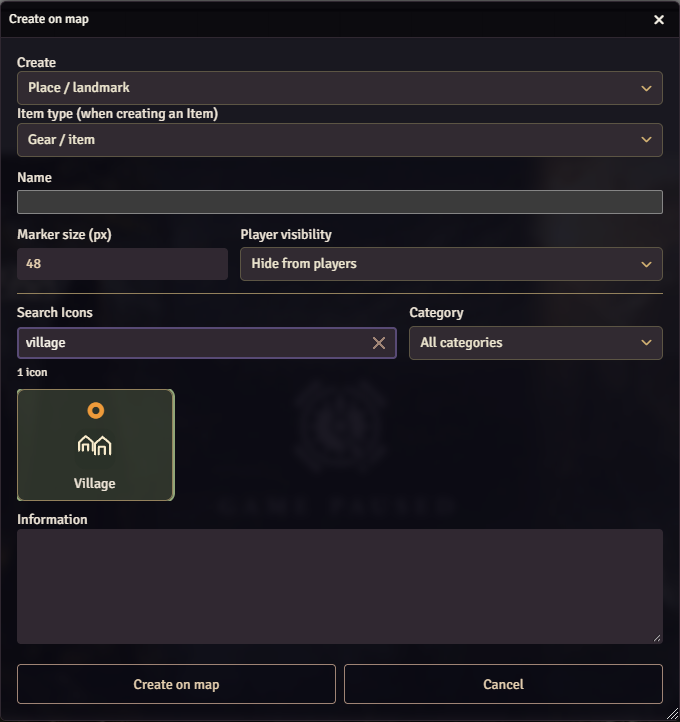

# Realm Guard / Torchbearer – användarmanual

Manualen beskriver **Realm Guard 1.13.11** i Foundry VTT 13.351. Knapparna anges med sina namn i Foundry. Exemplen gäller Legacy Mixed där en annan regelprofil inte anges.

## Innehåll

- [Kom igång](#kom-igång)
- [Karaktärer och utrustning](#karaktärer-och-utrustning)
- [Slag och utveckling](#slag-och-utveckling)
- [Spelpass och konflikter](#spelpass-och-konflikter)
- [NPC och compendia](#npc-och-compendia)
- [Kartor och GM-verktyg](#kartor-och-gm-verktyg)
- [Inställningar och felsökning](#inställningar-och-felsökning)

## Kom igång

### Första spelkvällen

Den här starten tar er från en öppnad värld till ert första slag. GM förbereder scen och behörigheter. Varje spelare behöver kunna öppna och styra sin egen karaktär.

1. **GM** öppnar världen, kontrollerar regelprofilen i **Configure Settings → Realm Guard / Torchbearer → Rules Profile Management** och tilldelar varje spelare ägarskap över sin Actor. Öppna en scen där spelarna kan hitta sina tokens.
2. **Spelaren** ansluter via världens adress och öppnar karaktären från **Actors** eller genom att dubbelklicka på sin token. Kontrollera att rätt karaktär är vald för användaren i Foundry. Det underlättar Help-förfrågningar och deltagarlistor.
3. Klicka på den Skill eller Ability som GM ber om. Kontrollera **Obstacle** eller motståndare och välj **Roll**. Läs utfallet på chattkortet och slutför eventuella val för Fate, omslag och Learning.
4. GM öppnar **Conflict Engine** när spelarna behöver lösa flera handlingar som en gruppkonflikt. Använd **Turn Manager** om ni spelar med GM Turn och Players’ Turn. Avsluta spelpasset i **End Session**.

### Hitta rätt instruktion i manualen

Öppna **System Manual & Rules Reference** med bokikonen vid sidopanelen, från chatten eller via **GM Dock**. Här finns både instruktioner för knapparna och regelreferensen för spelbordet.

1. Skriv namnet på knappen eller det du vill göra i sökfältet, till exempel **Pass Checks**, **Respond** eller **Import Image Folder**. Matchande avsnitt öppnas så att du kan läsa stegen direkt.
2. Rensa sökfältet för att se alla avsnitt igen. Använd **Expand All** för att läsa flera avsnitt i följd och **Collapse All** för att snabbt se rubrikerna.
3. Öppna **Open Active Profile Rules** när frågan gäller en regel i världens aktiva profil, till exempel hur Wises fungerar.

### Ord du möter på bladet

**Actor** är den sparade karaktären i Foundry. En **token** är instansen på kartan, och **Prototype Token** innehåller utgångsvärdena för nästa placering. Därför kan en ändring på prototypen kräva ett separat val för att påverka tokens som redan ligger på en scen. Ett **Actor Compendium** är ett bibliotek med karaktärer som du kan ta fram vid behov. När en NPC tas fram ur ett compendium skapas en världskopia.

**Skill** är en tränad eller otränad färdighet. **Ability** är ett grundvärde som Health eller Will. **D** står för tärningar i poolen, så **3D** betyder tre tärningar. Ett **Check** är en spelresurs, medan **Learning** är markeringarna som kan utveckla ett värde.

### Installera och uppdatera Realm Guard

Installera systemet i Foundry en gång per server. Därefter kan flera världar använda samma installation. Ett lokalt QA-paket installeras manuellt och passar i en separat testinstans.

1. Öppna Foundrys **Setup → Game Systems → Install System**.
2. Sätt in den [stabila manifestadressen](https://raw.githubusercontent.com/GuteboysFactory/RealmGuard-Torchbearer/main/channels/stable/system.json) i **Manifest URL** och installera.
3. Välj **Realm Guard / Torchbearer** när du skapar en värld. För en befintlig värld använder du systemets uppdateringsknapp i **Game Systems** och kontrollerar versionsnumret innan du öppnar världen.

För ett lokalt QA-paket stänger du Foundrys testinstans, flyttar undan testinstansens befintliga systemmapp och packar upp i **Data/systems/realm-guard**. **system.json** ska ligga direkt i den mappen. Kontrollera QA-numret efter omstart. Om QA-versionen har ett högre nummer än stable kan du behöva installera stable från dess manifest eller releasepaket för att byta tillbaka. Använd en separat testvärld så att den vanliga kampanjen har sin egen installation.

### Välj och förstå regelprofilen

Regelprofilen avgör vilka regelval, uträkningar och arbetsflöden världen använder. Som GM kan du granska en annan profil före ett eventuellt byte.

- **Legacy Mixed** används av många befintliga Realm Guard-världar. Realm Guard går först där det har egna regler. Mouse Guard 2E används för ärvda regler och utvalda Torchbearer 2E-idéer ingår där de anges. Här finns också Compact-bladen och kartans särskilda GM-meny.
- **Strict Realm Guard** följer projektets regelkälla för Realm Guard v1.6 och dess Mouse Guard 1E-linje. Använd profilens referens för till exempel Traits, Wises och Nature.
- **Mouse Guard 1E** och **Mouse Guard 2E** har egna regelval och skapandeflöden. Vilka val som syns under ett slag kan skilja sig från Legacy Mixed.
- **Torchbearer 2E** visas som förhandsgranskning i stabila Realm Guard. Profilens status i menyn visar vilka delar som går att förhandsgranska.

1. Öppna **Configure Settings → Realm Guard / Torchbearer → Rules Profile Management** och välj **Manage Rules Profile**.
2. Läs **World Impact Snapshot** för att se världens omfattning. Öppna profilens förhandsgranskning för att se vilka regler och arbetsflöden som berörs. Förhandsgranskningen är skrivskyddad.
3. Slutför öppna slag och gör eventuella profilbyten mellan spelpass. Bekräfta bytet och följ dialogens instruktion om att ladda om klienterna. Kontrollera sedan den aktiva profilen i samma fönster.

**Open Active Profile Rules** öppnar den aktiva källprofilens regelreferens. Från Legacy Mixed finns förhandsgranskning av Strict och MG1E. **Open Legacy Mixed Rules Journal** öppnar den permanenta Legacy Mixed-journalen.

## Karaktärer och utrustning

### Skapa en Ranger med Recruitment

**Create Ranger** skapar en spelarkaraktär med profilens startvärden, färdigheter och utrustning. Välj **GUIDED** för förklaringar vid varje steg eller **QUICK** när du känner till valen. Båda använder samma profilregler. Öppna **Recruitment Guide** om du vill läsa igenom stegen först.

1. Välj namn, Concept, Station och ålder. Station styr bland annat startvärden och antal val.
2. Besvara Nature-frågorna. I Realm Guards rekrytering är Dúnadan Nature kopplad till Tradition, Family och Grief.
3. Välj Homeland och fördela Natural Talent, Life Experience, Service och Specialty. Läs budgeten i steget. Natural Talent i rekryteringen är ett färdighetsval. Talents från Level Up hör till senare progression.
4. Fyll i Wises, Resources, Circles, Traits och relationer. Granska föreslagna NPC:er för exempelvis Parents, Senior Artisan, Mentor, Friend och Enemy. Den särskilda husregeln **Allow Servants of the Enemy as personal Enemies** lägger till sådana fiendeval där Realm Guard normalt föreslår de fria folken.
5. Skriv Belief, Goal och Instinct och granska startutrustningen. Bekräfta sammanfattningen så skapas karaktären i **Actors → PC**, med mappen skapad vid behov.

Om spelaren saknar rätt att skapa eller redigera en Actor behöver GM justera behörigheten eller skapa karaktären åt spelaren. Tilldela ägarskap innan ni använder karaktären för Help, Checks eller Versus.

### Spelarbladet och dess layouter

Dubbelklicka på din token eller öppna karaktären från **Actors**. De tre huvudflikarna används till olika delar av spelet.

| Vill du göra detta? | Öppna |
| --- | --- |
| Hantera Wises, Traits och Talents | **Character → Overview** |
| Ändra bakgrund eller Concept i Compact | **Character → Background** |
| Hitta karaktärens relationer och kontakter | **Character → Relationships** |
| Spara egna anteckningar | **Character → Notes** |
| Slå, lägga till eller redigera en färdighet | **Skills** |
| Se vad karaktären bär och var det ligger | **Inventory & Gear** |

I Legacy Mixed väljer ägaren **Sheet layout → Follow world default**, **Compact** eller **Detailed**. Compact behåller den samlade överdelen när du byter mellan huvudflikarna. Nature, Will, Health, Resources, Circles, Conditions och **Custom Roll** finns vid överdelen. Klicka på **Nature**, **Belief**, **Goal**, **Instinct** eller **Creed** för att byta berättelsefält. Nature-rutan visar själva värdet, maximum och Tax.

GM väljer **Legacy Mixed · Default player sheet** i världens inställningar. **Legacy Mixed · Apply default to all player sheets** använder världens layout tillfälligt på alla blad. Spelarnas egna val används igen när den tvingande inställningen stängs av.

Exempel vid bordet. Öppna **Skills** för att slå Scout och stanna på fliken när du sedan behöver titta på Conditions. I Compact finns Conditions kvar i överdelen. Byt till **Inventory & Gear** för att se utrustningen.

### Porträtt på bladet och token på kartan

**Character Portrait** bestämmer vilken bild och vilket utsnitt spelarbladet visar. Kartans token har en egen bild i **Prototype Token** och egna inställningar efter placering.

1. Klicka på porträttet på spelarbladet. Välj **Original Portrait** eller **Token Portrait** när en tokenbild finns.
2. Dra bilden i förhandsvisningen och använd **Zoom**, **Center**, **Fit** eller **Fill** för att få rätt utsnitt.
3. Välj **Save Portrait** och kontrollera resultatet på bladet. Realm Guard sparar utsnittet separat för de två lägena. Palettknappen öppnar systemets medföljande bilder.

Sedan **1.13.9** finns själva Token Builder i **Adventurer’s Tome**. Aktivera en Tome-version som innehåller verktyget. Öppna dess knapp vid bilden på spelar- eller NPC-bladet, välj en bild och ram, granska utsnittet och spara. Tome uppdaterar Actor-prototypens tokenbild. **Keep portrait upright** låter token byta riktning medan bilden står rättvänd. Om du vill uppdatera redan placerade tokens väljer du även scenalternativet när det erbjuds. Realm Guards separata porträtteditor använder den aktuella prototypbilden i Token Portrait-läget. Äldre bildfiler och tokens finns kvar.

### Inventarie, utrustning och behållare

Inventariet visar vad karaktären har, vad den använder och vad som är nedpackat. Du kan till exempel förvara en fackla i en väska och flytta den till en hand när den behövs.

1. Öppna **Inventory & Gear**. Lägg till Gear från bladet eller från ett medföljande eller eget compendium. Utrustning som saknar placering visas under **Unassigned Gear**.
2. Dra utrustning till rätt fält på figuren, till exempel **Left Hand**, **Right Hand**, **Head**, **Neck**, **Cloak**, **Torso**, **Belt**, **Pocket** eller **Feet**. Ett tvåhandsvapen upptar båda händerna och blockerar den andra handens placering.
3. Lägg föremål i en kompatibel behållare för att packa dem. Kontrollera kvantitet, placering och kapacitet på föremålets blad om du behöver reda ut varför något inte får plats. Dra tillbaka utrustning till **Unassigned Gear** när du vill frigöra platsen och behålla föremålet.
4. Välj det vapen eller verktyg som används för handlingen i konfliktens **Weapon / Tool**. Inventariets placering och konfliktens aktuella val fyller olika funktioner.

### Tokens of Power

Ett **Token of Power** är en relik eller kraft som kan påverka ett passande slag. Exempelvis kan en relik kopplad till Scout ge extra tärningar när Rangern spanar efter ett bakhåll.

1. Öppna föremålet i **Inventory & Gear**. Kontrollera nivå, vilken Skill eller Ability det hör till och vilken effekt det ger.
2. Öppna ett matchande slag. Välj reliken när den erbjuds och kontrollera ändringen i tärningspoolen eller på kortet för omslag. För en särskild situationsbunden användning bedömer bordet om den passar.
3. Läs användningsmarkeringen på bladet efter slaget. **Start Session** återställer effekter med en gräns per session.

I Legacy Mixed ger nivå 1 normalt +1D en gång per session, nivå 2 normalt +1D varje gång den länkade användningen passar och nivå 3 ett relevant omslag av misslyckade tärningar en gång per session. Bladet markerar användningen. **Start Session** återställer sessionsbundna effekter. Kontrollera föremålets konfiguration och den aktiva profilens referens för andra effekter.

## Slag och utveckling

### Vanliga slag och att läsa chattkortet

Använd ett vanligt Skill- eller Ability-slag när gruppen kommit överens om vad karaktären försöker göra och vad som händer vid framgång eller misslyckande.

1. Öppna slaget från en Skill under **Skills**, en Ability i överdelen eller ett värde i NPC:ns **Quick Skills**.
2. Kontrollera **Obstacle** och **Dice pool**. Välj stöd som faktiskt gäller för försöket. Ett slag mot Ob 2 behöver två framgångar.
3. Välj **Roll**, slutför erbjudna efterval och läs slutresultatet i chatten. Öppna detaljerna om du vill se hur poolen räknades ut.

- **Dice pool** visar tärningar och automatiska modifieringar. Använd **Extra Dice** för manuella extratärningar som bordet kommit överens om.
- **Obstacle**, ofta **Ob**, är antalet framgångar som krävs. I Legacy Mixed ger 4–6 en framgång. Tre framgångar mot Ob 2 ger **PASS** med marginal 1. Samma kast mot Ob 4 ger **FAIL** med en framgång för lite.
- **Count this test for Learning** låter ett berättigat test bokföras för utveckling. Slå av valet om ni exempelvis provar en pool utan att bokföra testet.
- Chattkortet visar tärningar, pass/fail/tie och marginal. Öppna detaljerna för att se varför tärningar lades till eller togs bort. Ägna efterval för Fate och omslag ett ögonblick innan ni går vidare.

### Custom Roll och Undo

Använd **Custom Roll → Free Dice Pool** för ett fristående kast där du själv anger tärningspoolen. Ange etikett och Ob när dialogen frågar efter dem, slå och läs resultatkortet. Den fria poolen bokför ingen Learning för en Skill eller Ability.

Om ett slag behöver korrigeras, öppna dess chattkort och välj **Undo** när knappen finns. Läs återställningen och kontrollera vilka senare val som redan bygger på slaget innan ni går vidare. I Legacy Mixed kan chattens automatiska följning hålla kortet synligt medan eftervalen slutförs.

### Versus, Respond och tiebreaker

**Versus** jämför två slag. Använd det när en motståndares handling sätter motståndet, till exempel när en spejare försöker passera en vakt som håller utkik.

1. Välj **Versus** i slagdialogen och ange ett mål där valet erbjuds. Välj motståndare via kartan eller listan i den dialog som överblickar motståndare. För en utmaning i chatten svarar motparten genom **Respond** och väljer den relevanta Skillen eller Abilityn.
2. När båda har slagit jämför systemet antalet framgångar. Vid lika resultat står det **TIE**.
3. I Legacy Mixed får båda kända deltagare ett gemensamt tiebreaker-kort. Varje sida väljer och bekräftar en tillgänglig förmåga, exempelvis **Will**, **Health** eller **Nature**. Klicka på knappen för din egen karaktär. Den anger vilket Ability du slår. GM slår för en GM-styrd motståndare.
4. Kortet visar vilken sida som återstår och därefter vinnare och marginal. Vid en andra tie mellan spelarkaraktärer avgör GM. Mot en GM-styrd motståndare går den andra tien till GM-sidan. En anonym utmaning har manuell tiehantering.

### Otränade Skills, Learning och framsteg

**Learning** bokför användning av en Skill eller Ability. En otränad Skill räknar försök, medan ett tränat värde normalt behöver både lyckade och misslyckade slag för att höjas.

En Skill på **0D** slås med **Beginner’s Luck**. Välj Will eller Health enligt dialogens villkor. I Legacy Mixed halveras den relevanta poolen före Persona och rundas uppåt. Tillåtna **Tap Nature**-tärningar läggs till efter halveringen. Försöket bokförs för den otränade färdigheten. När du når rätt antal försök lär sig karaktären normalt färdigheten på 2D.

Tränade Skills och Abilities visar Pass/Fail-kraven. Berättigade slag markerar utfallet. När båda kraven är uppfyllda höjs värdet automatiskt. Nature använder maximum vid beräkning av inlärningskravet. I Legacy Mixed höjer ett avancemang av beskattad Nature både Current och Maximum med ett. Beginner’s Luck utvecklar den utränade Skillen enligt sitt eget flöde.

1. Öppna **Skills** och välj färdigheten. Vid 0D går du igenom **Beginner’s Luck**-dialogen. Kontrollera att **Count this test for Learning** är aktivt om slaget ska bokföras.
2. Läs chattkortet och kontrollera Pass/Fail eller försöksräknaren på bladet. **P** och **F** visar sparade framgångs- och misslyckandemarkeringar jämfört med kraven för nästa värde.
3. Använd **Edit** när du behöver ändra en Skill. Där ligger också borttagning för egna Skills där det är tillåtet. En kanonisk NPC-Skill på 0D lämnar **Quick Skills**.

### Nature, Persona och Fate

**Nature** har ett aktuellt värde och ett maximum. Om handlingen följer en Nature descriptor bedömer bordet om Nature ska vara själva slaget. **Tap Nature** låter Nature stödja ett annat slag där alternativet är tillåtet. Läs Tax efter slaget. Aktuell Nature kan minska medan maximum ligger kvar. Särskilda slag som Resources och Circles använder egna begränsningar.

**Persona** ger tillåtna bonusar före slaget, normalt upp till +3D i Legacy Mixed. Persona kan också betala uttryckliga val som Tap Nature eller en Wise-effekt. **Fate** används när kortet erbjuder **Open 6s**. Då kan sexor ge följdtärningar innan resultatet räknas färdigt. En genomförd spendering kan räknas till **Lifetime Spent Fate/Persona**. Utdelning och GM:s plus/minus-korrigeringar är separata från den räknaren.

1. Välj ett rent Nature-slag från bladets **Nature** när handlingen passar. Om du slår en Skill och vill använda Nature som stöd väljer du **Tap Nature** i dialogen där det erbjuds.
2. Välj hur mycket Persona du vill lägga på slaget och kontrollera poolen före **Roll**. Läs eventuell **Tax** i resultatet och kontrollera Nature Current på bladet.
3. Om slaget ger sexor och du får **Open 6s**, välj om du vill spendera Fate. Vänta på slutresultatet innan du läser marginalen.

### Resources, Circles och kontakter

**Resources** används för att försöka få tag i varor eller tjänster. Klicka på **Resources** på bladet, gå igenom vad du försöker få tag i med GM och använd den svårighet som gäller för just köpet. Läs resultatet i chatten och kontrollera eventuell **Tax** på bladet. **Baseline Obstacle** styr vanliga slag. Resources har ett eget Ob-flöde.

**Circles** används för att hitta en person som kan hjälpa till. Klicka på **Circles** på bladet, beskriv vem du söker och hur tillgänglig personen borde vara. När profilen erbjuder Social Network väljer du sedan hur den personen hör ihop med karaktärens redan sparade relationer.

| Val | När det passar och vad som händer |
| --- | --- |
| **Standard Test** | Slå Circles för en situation där ingen kontaktpost behövs. |
| **Known Person** | Välj en person som finns i karaktärens nätverk. Slaget hänvisar till den personen. Du kan fortfarande behöva spela ut vad personen vill eller kan göra. |
| **Find New Person** | Beskriv en ny person. Ett lyckat slag kan lägga till en **Neutral Contact** i nätverket. Om ni vill spela personen på kartan skapar GM en NPC separat. |

Fortsätt till Circles-slaget, granska Ob och läs utfallet i chatten. Öppna **Character → Relationships** för att följa upp kontakter som sparats där. Vissa profiler ger en bonus för senare Circles-slag som gäller samma registrerade kontakt.

### Traits, Wises, Help och Synergy

Välj en relevant **Trait** för egen fördel i slagdialogen. I Legacy Mixed ger nivå 1 normalt +1D en gång per session. Nivå 2 ger +1D en gång per relevant slag utan sessionstak. Nivå 3 följer profilens regler för +1 framgång på ett annars lyckat eller bundet slag. **Trait Against** är ett annat sätt att använda en Trait och kan ge Checks i rätt GM Turn-situation.

I Legacy Mixed kan en relevant **Wise** bidra med +1D före ett slag eller betala 1 Persona för att slå om misslyckade tärningar när kortet erbjuder det. De två valen delar samma Wise-användning för slaget. Använd den aktiva profilens referens när andra regler för Wises eller Traits gäller.

1. Klicka **Ask for Help** när en patrolkamrat kan bidra.
2. Hjälparen får ett eget val, till exempel tränad Skill eller Ability för +1D, eller **I Am Wise** där en Wise passar. **Afraid** kan hindra en Ranger från att hjälpa.
3. Godkänd hjälp visas under **Help / Teamwork**. Spelaren som gör slaget kan förbereda det medan andra svarar. Om hjälparen väljer **Synergy** när det erbjuds kopplas Fate och eventuell Learning till den hjälparens valda källa. Den slutliga pass/fail-markeringen används efter ett avgjort slag. En ännu oavgjord tie förbrukar inte Fate i detta flöde.

### Level & Talents

I Legacy Mixed utgår **Level & Talents** från faktiskt spenderad Fate och Persona. Båda trösklarna måste uppnås. Se målen under **Character → Overview**. Du börjar på nivå 1 och får en Talent-plats på varje nivå från 2 till 10. Utdelning och manuell balansjustering räknas separat från verklig spendering.

| Nivå | Spenderad Fate totalt | Spenderad Persona totalt |
| --- | --- | --- |
| 2 | 3 | 3 |
| 3 | 7 | 6 |
| 4 | 14 | 9 |
| 5 | 22 | 12 |
| 6 | 31 | 16 |
| 7 | 41 | 20 |
| 8 | 52 | 24 |
| 9 | 64 | 28 |
| 10 | 77 | 32 |

Öppna Talent-väljaren när bladet visar en ledig plats. Sök eller filtrera på nivå och läs vilken Skill, Ability eller situation effekten gäller. **Passive**, **Once per Session** och **Once per Conflict** anger när effekten får användas. Bekräfta valet eller stäng och välj senare. Level & Talents är ett Foundry-tillägg till Realm Guard.

## Spelpass och konflikter

### Start Session och Session Break

**Start Session** förbereder ett nytt spelpass. Öppna verktyget som GM och bekräfta. Då återställs stödda Traits, Talents och Tokens of Power med en gräns per session. Karaktärernas Fate, Persona, Conditions och Learning ligger kvar.

**Session Break** visar en gemensam rasttimer och vem som är tillbaka.

1. Öppna **Session Break** som GM. Skriv till exempel **10:00** och välj **Start break**.
2. Varje deltagare klickar på **I am back** på sitt kort när den är tillbaka. GM ser statusen i rastfönstret.
3. Använd **Change timer** om ni behöver mer tid. Stäng rastfönstret när ni fortsätter pågående session.

### Turn Manager, Checks och Pass Checks

**Turn Manager** håller reda på spelarnas turer och testkostnader. GM väljer **Start GM Turn** eller **Start Players’ Turn**. I Legacy Mixed börjar en Ranger normalt Players’ Turn med ett **Free Test**. Om du vill göra ytterligare test granskar du Check-kostnaden i slagdialogen. **Done / Discard** avslutar den aktiva Rangerns spelartur och hanterar kvarvarande Checks enligt profilen.

**Pass Checks** överför en Check mellan spelarkaraktärer. Använd det till exempel när en patrolkamrat behöver ett extra försök.

1. Öppna din PC och klicka på pilen bredvid **Checks**.
2. Skriv rollpersonens namn i **Search patrol-mates**, välj mottagare och ange antal när dialogen erbjuder det. I Legacy Mixed är mottagaren normalt en patrolkamrat som saknar Checks.
3. Välj **Pass Check**. Kontrollera nya saldon och chattkortet som visar överföringen. Om mottagaren inte syns, kontrollera Actor-ägarskap, vald spelarkaraktär och mottagarens behörighet.

Pass Checks finns på spelarblad i **Legacy Mixed, Mouse Guard 1E och Mouse Guard 2E**. Funktionen fungerar även när Turn Manager är av och ni hanterar turerna manuellt. Med **Free Play** sköter bordet test- och turkostnaderna. Sparade Checks och övriga resurser finns kvar.

### Conditions och Recovery

**Conditions** är tillstånd som påverkar karaktärens handlingar. En skadad Ranger kan till exempel få färre tärningar på ett slag.

1. Öppna **Conditions** på spelar- eller NPC-bladet, i tokenens kontroller eller genom GM:s verktyg.
2. Klicka på tillståndet för att slå på eller av det. När det är aktivt syns dess ikon på tokenen på kartan. För musen över ikonen för att läsa effekt och återhämtningsvillkor. Ikonen är större och har mörk botten med ljus kant.
3. Öppna ett berört slag och läs modifieringen i tärningspoolen. Vilka slag och handlingar som påverkas beror på regelprofilen och tillståndet.

**Recovery** ger dig ett sätt att försöka bli av med en aktiv Condition enligt reglerna.

1. Öppna den aktiva Conditionen och välj **Recovery** där det erbjuds.
2. Följ villkoret eller slå den föreslagna Skillen eller Abilityn. Kontrollera kostnaden i dialogen när Turn Manager används. I Legacy Mixed kan tillåten Recovery i GM Turn kosta två Checks.
3. Vid lyckad automatiserad Recovery tas Conditionen bort. Ett misslyckat slag kan lämna den aktiv eller ge nästa steg enligt profilen. Läs utfallet före nästa Recovery.

Legacy Mixed använder ordningen **Hungry & Thirsty → Angry → Tired → Injured → Strained → Sick**. Exempel är Angry med Will Ob 2, Tired med Health Ob 3, Injured med Health Ob 4 och Strained med Will Ob 4. **Fresh** kan inte vara tillsammans med en annan aktiv Condition. **Afraid** har särskilda konsekvenser och kan hindra Help. GM kan skapa egna Conditions och välja manuell, Ability-baserad eller Skill-baserad Recovery.

**Sick** ger −1D på Skills, Nature, Will och Health. Resources, Circles och återhämtningsslag med Will eller Health är undantagna.

1. Öppna **Conditions** och välj **Recovery** vid **Sick** för att slå Will mot Ob 4 utan Help. Vid framgång stängs tillståndet av.
2. Vid misslyckande ligger Sick kvar. Slå **Healer** från läkarens blad med Ob 4 i Legacy Mixed och Mouse Guard 2E eller Ob 3 i Mouse Guard 1E. GM stänger av Sick på den sjuka karaktären om behandlingen lyckas.
3. Om behandlingen misslyckas eller karaktären avstår från den under Players’ Turn sänker GM en tillåten Skill eller Ability permanent med ett steg och stänger av Sick. Resources och Circles kan inte väljas.

Strict Realm Guard använder **Strained** som profilens motsvarande tillstånd.

### Conflict Engine från start till kompromiss

**Conflict Engine** leder båda lagen genom en längre konflikt, till exempel en jakt, en argumentation eller en strid. Den håller reda på mål, hemliga val, slag och lagens Disposition.

1. Öppna **Conflict Engine** från GM Dock eller kartans snabbmeny. Välj konflikttyp, deltagare och kapten. Kontrollera att båda sidor innehåller rätt Actors.
2. Skriv ett **Goal** för varje sida och välj **Save Goal**. När båda är klara går ni till **Starting Disposition**. Disposition är lagets gemensamma värde i konflikten. I ett beräknat startslag läggs framgångarna till full basförmåga. En otränad konfliktfärdighet använder Beginner’s Luck där det är tillämpligt. Oppositionen kan ha **Calculated**, **Nature**, **Fixed** eller **Manual** Disposition. Granska fördelningen om spelarna ska fördela lagets totalsumma.
3. Båda sidor väljer tre handlingar i hemlighet. **Attack** pressar motståndaren, **Defend** skyddar och kan återhämta Disposition, **Feint** kan komma runt ett försvar och **Maneuver** skapar ett taktiskt övertag. Guiden i fönstret förklarar korten. Matrisen avgör sedan om kombinationen är Independent, Versus eller Trumped.
4. Kaptenen tilldelar varje handling till en deltagare och väljer **Exchange Weapon / Tool**. En Actor använder samma tilldelade verktyg under det aktuella utbytet med tre handlingar och kan välja ett nytt i nästa utbyte. Fight kan använda lämpliga vapen från utrustningen. Andra konflikter kan använda sparade eller improviserade verktyg. Ett anpassat verktyg kan gälla för konflikten eller sparas på Actor. Kontrollera kraven för kortet och eventuell **Unarmed**-effekt i panelen.
5. Lås planerna. När båda är låsta visas första paret. Slå och läs resultatkortet. Där ser du båda sidors tärningar, Help, om Disposition ändras och eventuella Maneuver-val. Nästa par går vidare när handlingen och dess efterval har lösts. **Exchange History** visar tidigare handlingar.
6. När en sida når noll Disposition visas **Conflict Complete**. Öppna kompromissvalet och använd vägledningen för att bedöma konsekvenserna av förlorad Disposition. Bordet avgör den konkreta kompromissen och hur den kommer in i berättelsen.

Om konflikten väntar, kontrollera om någon ännu ska spara målet, tilldela en Actor, låsa planen, slå eller välja en Maneuver. **Abort** avslutar en felstartad konflikt och rensar dess tillfälliga tillstånd. Läs det senaste chattkortet innan du börjar om.

### End Session och belöningar

**End Session** samlar genomgången och sparar belöningarna på rätt karaktärer.

1. Öppna **End Session** som GM. Markera dem som deltog och gå igenom deras Belief, Goal och Instinct med gruppen.
2. Välj **Review Awards**. Kontrollera mottagare och hur mycket Fate eller Persona varje karaktär ska få.
3. Välj **Finish Session** när fördelningen stämmer. Då sparas belöningarna. Välj **Start Next Session** när nästa spelpass börjar.

I Legacy Mixed kan följd Belief, framsteg mot ett oavslutat Goal och spelad Instinct ge Fate. Uppnått Goal och att spela emot sin Belief kan ge Persona. **MVP** och **Workhorse** går till en Ranger var och till olika personer. **Embodiment** gäller gestaltning och kan tilldelas fler än en Ranger, men normalt inte hela gruppen. Solospel har ett undantag för den enda Rangern. Läs genomgången före utdelning så att belöningar uppdateras en gång per session.

## NPC och compendia

### Skapa och redigera NPC:er

En NPC som skapas med de här verktygen sparas som en redigerbar Actor. Välj arbetsflöde utifrån vad du redan har förberett.

| Om du behöver | Gör så här |
| --- | --- |
| En enskild NPC med egna värden | Öppna **GM Control → Quick NPC**, fyll i namn och grundvärden och välj eventuellt utrustningspaket. Bekräfta och kontrollera bladet i **Actors**. |
| En färdig hantverkare, vakt eller annan roll | Öppna **Quick NPC Library** i GM Dock. Sök på exempelvis yrke, kultur eller kompetens och välj **Create** på kortet. Öppna kopian under **Actors → NPC** för att justera den. |
| Flera NPC:er som hör ihop | Öppna **Quick NPC Library → Group Templates**. Välj en grupp, granska medlemmarna och bekräfta vilka som ska skapas. |

I Legacy Mixed väljer du **Sheet type → NPC**, **Monster** eller **Animal**. Bladet visar Nature och descriptors samt Will, Health, Resources och Circles. **Quick Skills** visar tränade Skills. **NPC Notes** används för exempelvis motivation, specialregler eller taktik. På bladet finns även Conditions, Traits, Wises, Talents, Tokens of Power och utrustning.

Dra en stödd Item från ett compendium till NPC-bladet. Realm Guard tolkar dess typ, till exempel Skill, Wise, Trait, Gear, Condition, Talent eller Token of Power. För Skills väljer du värdet. En kanonisk förmåga som redan finns på 0D aktiveras i sin befintliga post. För andra Items kan du få ett val om en post med samma namn redan finns.

### Skapa från en bild eller dra ut en compendium-mall

Använd bilden som utgångspunkt när du vill skapa en ny NPC med ett visst utseende. Använd compendium-mallen direkt när karaktären redan finns förberedd där.

- **Bild till ett mallkort.** Dra en bild från datorn direkt till den mall du vill använda i **Quick NPC Library**. Realm Guard skapar en NPC med bilden och stats från mallen. Filnamnet föreslås som namn. **NPC Compendium** väljer vilket pack mallarna hämtas från.
- **Bild till kartan.** Släpp en bild på kartan som GM och välj en mall. När du valt mallen skapas en NPC och en token placeras vid släppunkten. Du kan rama in bilden senare i Tomes Token Builder.
- **Compendium till Actors.** Dra en NPC till **Actors** för en separat världskopia. Dokumentet i compendiet finns kvar.
- **Compendium till kartan.** Dra mallen till kartan för både en Actor-kopia och en token. Ett ledigt Actor-namn skapas direkt. Om en Actor redan har samma namn öppnas **Name NPC**. Ange ett nytt namn eller välj **Keep Original Name**. Token-namnet följer namnet på den nya NPC:n när mallen använde sitt Actor-namn. Ett Item med samma namn stoppar inte mallen.

### Importera en bildmapp till ett nytt compendium

Det här verktyget bygger ett NPC-bibliotek från många bilder på en gång. Om du har en mapp med porträtt på bybor kan du använda en gemensam mall för gruppen och välja en annan mall för exempelvis byns vakt.

1. Öppna **Quick NPC Library** och välj mappens mallkälla i **NPC Compendium**. Klicka **Import Image Folder** och välj bildmappen på datorn.
2. Granska listan. Bilder i undermappar följer med när webbläsarens mappval inkluderar dem. Tomma och ej stödda filer hoppas över. PNG, JPG och WebP är exempel på stödda format.
3. Ange namn på det nya **Actor Compendium** och välj **Default Template**. Du kan redigera **NPC Name** och använda **Template Override** på enskilda rader. Utan en egen mall på raden används standardmallen.
4. Klicka **Create Compendium**. Varje rad får en uppladdad bild och mallens stats i det nya compendiet. Bilder med samma filnamn får skilda sökvägar. Vid fel kan **Retry Failed Rows** göra ett nytt försök i samma dialog och behålla tidigare lyckade rader.
5. Öppna resultatet i **Compendium Packs** och granska ett par NPC:er. Dra ut en NPC till Actors eller kartan när du behöver den.

### Arkivera befintliga NPC:er

Det här verktyget utgår från NPC:er som redan finns i världen och kopierar deras namn, porträtt, tokeninställningar, stats, anteckningar, Items och Active Effects.

1. Öppna **GM Dock → Quick NPC Library → Archive NPCs** som GM. Välj en **Actor Folder** för att se dess NPC:er och undermappar. **Find NPC** söker på namn och **Select Visible** markerar resultaten. Ändra filter för att lägga till NPC:er från andra mappar i samma urval.
2. Namnge det nya **Actor Compendium** och välj **Create Archive**. Realm Guard skapar ett GM-privat compendium och jämför varje kopia med originalet. Läs antal verifierade kopior. Använd **Retry Unverified Copies** i samma dialog om någon rad misslyckades.
3. Efter verifieringen kan du stänga dialogen och behålla både original och kopior. För att frigöra utrymme i Actors-listan markerar du de original du vill ta bort och väljer **Remove Selected Originals**. Bekräfta separat. NPC:er med tokens även i inaktiva scener eller med stridsdeltagare skyddas. Ett original lämnas också kvar om det eller arkivkopian ändrats sedan verifieringen.
4. När du vill ta fram en NPC igen öppnar du arkivet i **Compendium Packs** och drar den till Actors eller kartan. Foundry skapar en ny världskopia. Uppdatera vid behov länkar som pekade på den borttagna Actor-identiteten.

### Applicera en statsmall på en befintlig NPC

**Apply Stats Template** ersätter grundvärden och Skills på en befintlig NPC. Albertus har till exempel redan rätt porträtt, token och namn, men behöver en vakts stats.

1. Öppna Albertus blad. Under **Quick Skills** klickar du **Apply Stats Template**.
2. I **Stats Source** väljer du **Starter NPC Templates**, ett eget **Actor Compendium** eller **World NPCs** för NPC:er som redan finns under **Actors**. Sök på namn och välj **Select** vid rätt NPC. Om flera har samma namn visas mappsökvägen på kortet för en NPC från världen.
3. Läs **Review NPC Stats**. Kolumnerna **Current** och **Template** visar värdena före och efter. Klicka på **Cancel** om du vill avbryta.
4. Välj **Apply Stats**. Nature, Will, Health, Resources och Circles får källans värden och gränser. Matchande Skills uppdateras och nya tränade Skills läggs till. Skills som saknas i källan sätts till **0D** och försvinner från Quick Skills.
5. Kontrollera de nya värdena på bladet. Albertus är samma Actor och behåller namn, porträtt, token, anteckningar och utrustning. Käll-NPC:n är oförändrad.

## Kartor och GM-verktyg

### Kartmarkörer och snabbkommandon

I Legacy Mixed använder GM kartans högerklicksmeny. Stå i tokenlagret för att öppna menyn på en tom kartpunkt. Befintliga markörer kan även hanteras från notlagret när markören kan pekas ut.

1. Högerklicka på rätt plats och välj **Create item / place on map…**.
2. Ange **Name** och använd **Search Icons** för att hitta ikonen. Sök exempelvis **Village**, **City**, en butik eller en fontän. Välj storlek och om spelarna ska se markören.
3. Klicka **Create on map**. Högerklicka på markören för **Edit**, **Move marker…**, **Show to players**, **Hide from players**, **Resize all markers on this scene…** eller **Delete**. Om markören har en länkad journal kan du öppna den från editorn.
4. Peka på en markör eller token och tryck **H** för att växla synlighet i det aktiva lagret. GM kan ändra kortkommandot i **Configure Controls**. Håll Shift när du högerklickar för Foundrys vanliga meny.

Håll muspekaren över en token för att se dess namn. På tokenmenyn finns **Open character sheet**, **Conditions**, **Custom Roll**, **Select as opponent** och **Foundry token controls**. På en tom plats kan du också välja **Place existing NPC…**, välja en NPC från världen och placera en token för den befintliga Actorn.

### GM Dock och GM Control

**GM Dock** samlar genvägar till verktyg du använder under spel. Håll muspekaren över en ikon för att se dess namn. I Legacy Mixed är sessionens verktyg samlade under **Session**, medan **Other tools** visar fler val. Öppna **Customize quick access…** för att välja genvägarna du använder mest. Dra docken i greppet för att flytta den och välj **Reset GM Dock position** om du vill återställa platsen.

**GM Control** låter dig arbeta med enskilda tokens eller hela urvalet. Markera tokens på kartan och öppna **GM Control**. Kontrollera vilka som står under **Selected Tokens** innan du öppnar ett blad, centrerar kartan, slår eller ändrar något. För en effekt på flera NPC:er samtidigt markerar du gruppen och öppnar **Group Conditions**.

**Group Resource Admin** justerar resurssaldot för flera Actors samtidigt. Kontrollera namnen i urvalet, välj **Fate**, **Persona** eller **Checks** och ange beloppet i **Change**. En positiv ändring lägger till resurser och en negativ drar av. Klicka **Apply**. Varje vald Actor justeras inom profilens gränser. Kontrollera saldona innan ni fortsätter.

### Obstacle Control under spel

**Obstacle Control** låter GM sätta svårigheten för vanliga slag utan att öppna varje karaktärsblad. Öppna verktyget i GM Dock.

- **Baseline Obstacle** styr startvärdet för kommande vanliga Skill- och Ability-slag. En ny värld börjar normalt på Ob 2. Läs panelens aktuella värde innan ni börjar.
- **Change Open Rolls Live** ändrar Ob i redan öppna slag som fortfarande följer Baseline. **Reset** återställer dessa öppna slag till Baseline. När spelaren själv redigerar Ob kan det enskilda slaget sluta följa liveändringar.
- **Ordinary Roll Workflow** växlar mellan vanlig Baseline, GM-godkännande per vanligt slag och manuell Ob i varje slag. Med GM-godkännande kan GM granska eller justera värdet medan spelaren gör andra val.

Versus, Resources, Circles och andra regelstyrda test har sina egna förutsättningar. Svårighetsguiden hjälper när bordet behöver välja en rimlig nivå. GM avgör vilka faktorer som gäller i den konkreta situationen.

Exempel. Om flera vanliga slag ska utgå från Ob 3, ställ in **Baseline Obstacle** inför scenen. Om spelarna redan har öppnat sina slag använder du **Change Open Rolls Live** för de dialoger som fortfarande följer Baseline. Be spelarna kontrollera sitt Ob innan de slår.

### Starter Compendiums och egna bibliotek

**Starter Compendiums** ger världen återanvändbara Skills, Traits, Wises, Conditions, Gear, Tokens of Power, Talents och NPC Templates. Om en standardpost saknas, öppna **Starter Compendiums** som GM, välj biblioteket du vill fylla på och använd **Add Missing Entries**. Kontrollera resultatet under **Compendium Packs**. Egna eller redigerade dokument blir kvar.

När du organiserar befintliga dokument i Foundry kan du skapa ett eget compendium av motsvarande typ och dra in dokument dit. För en hel mapp öppnar du mappens meny och väljer **Export to Compendium**. Välj ett upplåst compendium. Läs särskilt valen om uppdatering efter namn och ID, eftersom de kan skriva över poster i ett befintligt pack. Ett arkiv skapat med **Archive NPCs** har sitt eget flöde för verifiering och valfri borttagning av original.

### Content Studio

**Content Studio** hjälper GM att skapa kampanjinnehåll och bestämma var det ska sparas. Du kan exempelvis göra en variantskada från en befintlig Condition eller skapa egen utrustning till ett bibliotek.

1. Öppna **Content Studio** som GM och välj typen du vill skapa. Använd **Duplicate & Modify** om du vill starta från en befintlig post.
2. Fyll i fälten och välj destination. Möjliga destinationer beror på vilken typ du valt och kan vara världen, en Actor eller ett upplåst kompatibelt compendium.
3. Granska **Review Before Create**. Kontrollera innehåll och destination och läs eventuella meddelanden om liknande poster. Bekräfta och öppna det skapade dokumentet från destinationen.

Spelarkaraktärer som ska följa rekryteringsreglerna skapas via **Create Ranger**.

### World Health Audit och andra diagnostikverktyg

**World Health Audit** gör en skrivskyddad genomgång av världen. Använd den till exempel efter en uppdatering eller om ett blad visar oväntade värden.

1. Öppna **World Health Audit** från manualen eller GM:s **Settings, Libraries & Diagnostics**.
2. Kontrollera version, världsdata och starterbibliotek. Läs sedan eventuella avvikelser för berörd karaktär, exempelvis dubbletter, resursgränser, utrustningsplacering, progression eller effekter.
3. Öppna det berörda bladet eller biblioteket och jämför med rapporten innan du ändrar något. Kör genomgången igen för att följa upp.

Administrationsmenyn innehåller kompletterande statusvyer för regelprofil, testflöden, effekter, inventarie och progression där de är tillgängliga. **World Impact Snapshot** hör till profilhanteringen och hjälper GM att bedöma ett eventuellt regelbyte.

## Inställningar och felsökning

### Inställningar som används vid bordet

Öppna **Game Settings → Configure Settings → Realm Guard / Torchbearer**.

| Inställning | Vad den ändrar |
| --- | --- |
| **Rules Profile Management** | Förhandsgranska profil och världens omfattning, välj regler för världen och ladda om enligt instruktionen. |
| **Use GM Turn / Players' Turn Manager** | Aktivera GM Turn, Players’ Turn och automatiserade Check-kostnader eller använd Free Play. |
| **Legacy Mixed · Default player sheet** | Bestämmer layouten för karaktärer som följer världens standard. |
| **Legacy Mixed · Apply default to all player sheets** | Använder den valda standarden tillfälligt för alla spelarblad. |
| **Show Macro Hotbar** | Visar Foundrys numrerade makrorutor för den inloggade användaren. De är dolda som standard. Ljud och meny ligger vid spelarlistan och anpassas när makroraden tar plats på en smal skärm. |
| **Default Realm Guard Actor & Token Art** | Väljer systemets standardbilder där en ny Actor använder en standardbild. |
| **Settings, Libraries & Diagnostics** | Öppnar GM:s bibliotek, diagnostik, Obstacle Control och dockinställningar. |

För att visa världens egen text på inloggningssidan, fyll i **Edit World → World Description** och använd **Default** för Foundrys **Join Page Theme**.

### Regelreferensen och bordets beslut

Öppna **System Manual & Rules Reference** när ni vill förstå varför systemet erbjuder ett val eller räknar ut något på ett visst sätt. Sök på regeln och använd **Open Active Profile Rules** när den kan skilja sig mellan profilerna.

Markörerna i den inbyggda referensen betyder **RULE** för en regel som systemet använder, **AUTOMATED** för bokföring i Foundry, **GM CALL** för bordets bedömning och **RG/TB FOUNDRY** för ett tillägg i systemet. Använd den aktiva profilens regler vid skillnader mellan Legacy Mixed, Strict, MG1E och MG2E.

Foundry räknar tärningar, bokför resurser och Learning, hanterar inventarieplatser, Conditions, både öppna och dolda konfliktval och sparad progression. Spelarna och GM avgör om test behövs, vad som står på spel, vad som följer Nature och vad en kompromiss betyder i berättelsen.

Den permanenta **Realm Guard / Torchbearer - Rules Reference**-journalen innehåller Legacy Mixed-regler och kan läsas av spelare. Realm Guard skapar den om den saknas. Ett redan sparat världsexemplar kan ha äldre text eftersom världsladdningen lämnar befintligt journalinnehåll kvar. Läs då den aktuella hjälpdialogen och den aktiva regelprofilen. [Öppna den medföljande regelreferensen](RULES_REFERENCE.md).

### Säkerhetskopiera och flytta en värld

En säkerhetskopia låter dig återställa kampanjens Actors, scener, bibliotek, inställningar och bilder vid en serverflytt eller ett problem efter en uppdatering.

1. Säkerhetskopiera Foundry-världen och dess tillgångar före en större uppdatering, ett profilbyte eller en serverflytt. Inkludera egna bilder och ljud som ligger utanför själva världsmappen. Till exempel kan uppladdade NPC-bilder och äldre tokens ligga i separata mappar.
2. Installera en kompatibel Realm Guard-version på destinationen. Installera och aktivera även de moduler världen använder.
3. Återställ den faktiska världsdatan enligt din server eller värdtjänst. Actors, NPC:er, Scenes, Journals, Items, egna compendia, progression och inställningar ligger med världen. Systempaketet har intern identitet **realm-guard** och innehåller systemkod och medföljande material.
4. Starta den återställda världen. Kontrollera systemversion, profil, några Actors, en scen och ett eget compendium. Kör **World Health Audit** och kontrollera bildsökvägar och behörigheter innan spelarna ansluter.

### Felsökning steg för steg

| Symtom | Kontrollera först |
| --- | --- |
| En knapp som guiden nämner saknas | Kontrollera systemversion, aktiv profil, GM-roll och Actor-ägarskap. **Archive NPCs** och **Apply Stats Template** finns från 1.13.10. |
| Token Builder saknas | Kontrollera att en Tome-version med Token Builder är installerad och aktiv. Kontrollera behörighet till Actor och Foundrys rätt att ladda upp filer. |
| Bild saknas efter import | Kontrollera filformat och dialogens status. Se om bildfilen finns på Foundry-värden och att bilden går att hämta från klienten. |
| Slaget väntar | Läs kortets status. Se om **Respond**, efterval, tiebreaker eller GM:s Ob-godkännande återstår och om rätt person har Actor-ägarskap. |
| Arkivet låter inte ett original tas bort | Statusraden visar om kopian verifierats, om NPC:n används av en token eller stridsdeltagare eller om originalet eller kopian har ändrats. |
| Foundry fryser | Anteckna vem som påverkas, tidpunkt, scen, vilket blad som var öppet och om hela fönstret eller bara kartan stannade. Fråga om andra spelare märkte samma sak. |

Om ett fel kvarstår, skriv ned exakt steg, systemversion, Foundry-version och regelprofil. Ta med den första relevanta raden i webbläsarens **F12 → Console** och eventuell Audit-rapport. Använd en kopia av världen för felsökning som ändrar data.
