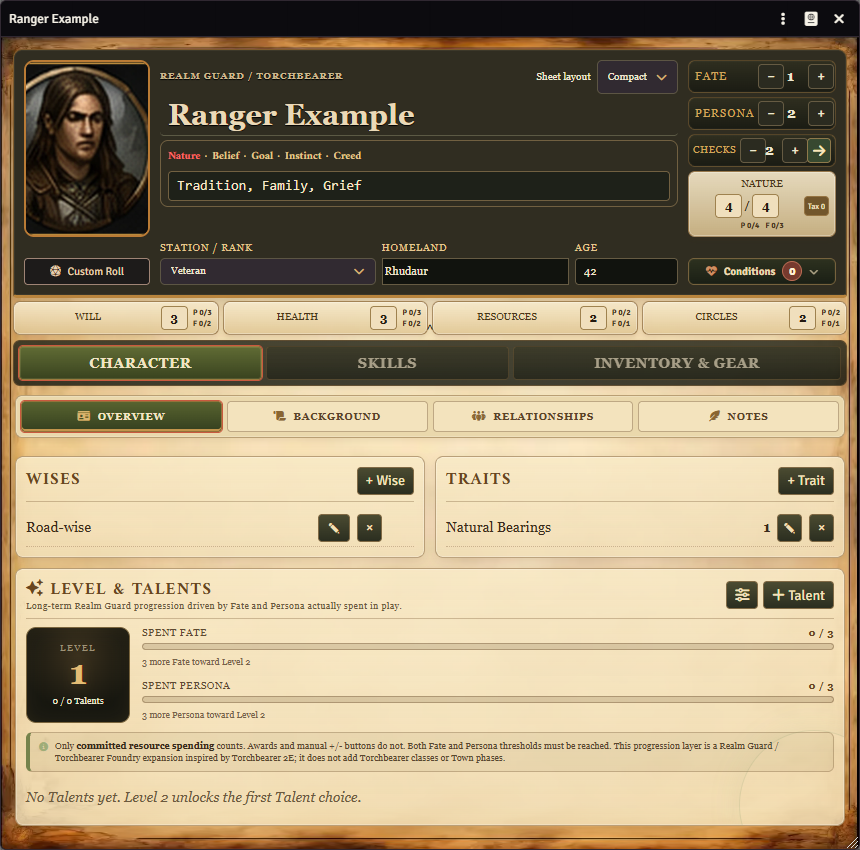
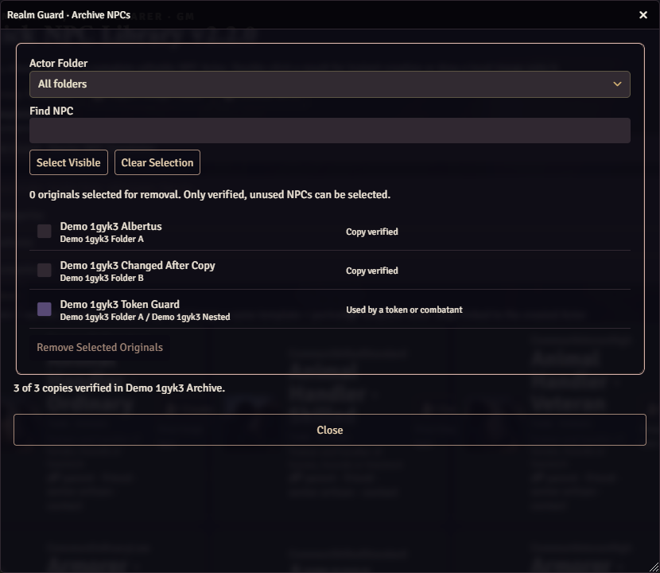
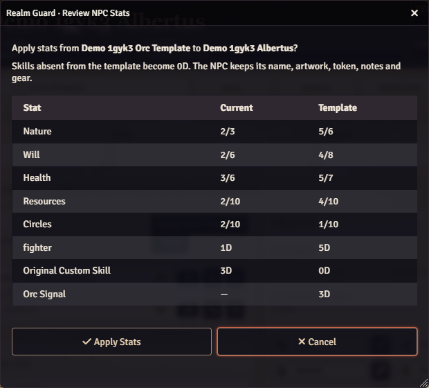

# Realm Guard / Torchbearer — User Manual

This guide covers **Realm Guard 1.13.13**, including the character creation and practice guides, tested in Foundry VTT 13.351. Button names match the Foundry interface. Examples use Legacy Mixed unless another Rules Profile is named. [Svenska](SYSTEM_MANUAL.sv.md)

## Contents

- [Getting started](#getting-started)
- [Characters and equipment](#characters-and-equipment)
- [Rolling and advancement](#rolling-and-advancement)
- [Sessions and conflicts](#sessions-and-conflicts)
- [NPCs and compendia](#npcs-and-compendia)
- [Maps and GM tools](#maps-and-gm-tools)
- [Settings and troubleshooting](#settings-and-troubleshooting)
- [Advanced examples](#advanced-examples)

## Getting started

### Your first session

1. **GM** opens the world and checks **Configure Settings → Realm Guard / Torchbearer → Rules Profile Management**. Open a scene with the party's tokens and give players ownership of any existing characters.
2. **Players** join at the world's address. Open a character under **Actors** or double-click its token. If you need a character, use **Recruit Ranger** or **Create Ranger**. Realm Guard grants ownership automatically.
3. When the GM asks for a test, open the relevant Skill or Ability. Check the **Obstacle** or opponent, click **Roll**, then resolve any choices on the chat card.
4. Use **Turn Manager** for GM Turn and Players’ Turn, **Conflict Engine** for a structured conflict, and **End Session** for rewards.

### Find help in the manual

Open **System Manual & Rules Reference** with the book icon beside the sidebar, from chat, or from GM Dock. The toolbar offers **English** and **Svenska** and remembers your choice. Search by task or interface label, such as **Pass Checks**, **Respond**, or **Import Image Folder**. Clear the search to see all topics. Use **Expand All** or **Collapse All** to change what is open.

In Legacy Mixed, **Start Guide** opens an optional walkthrough. Try **Create Your Ranger**, **Find Your Way Around the Character Sheet**, or **Make Your First Roll**. The practice roll uses a guide window and leaves your characters, resources, and world chat untouched. Use **Open Active Profile Rules** where offered for profile-specific mechanics.

### Terms on the sheet

An **Actor** is a saved character. A **token** is a placement on a scene. **Prototype Token** stores defaults for future placements. Existing tokens can have their own settings. An **Actor Compendium** is a reusable library. Importing from it creates a world copy.

A **Skill** is a trained or untrained proficiency. An **Ability** is a core stat, such as Health or Will. **3D** means three dice. A **Check** is a resource used in play. **Learning** tracks progress towards improving a rating.

### Install and update Realm Guard

1. In Setup, choose **Game Systems → Install System** and paste the stable address into **Manifest URL**. [Stable manifest](https://raw.githubusercontent.com/GuteboysFactory/RealmGuard-Torchbearer/main/channels/stable/system.json)
2. Choose **Realm Guard / Torchbearer** for a new world. For an existing installation use the update button in **Game Systems** and check the version before launching.
3. To install a local QA ZIP, stop your test instance, move its system folder aside, and unpack into **Data/systems/realm-guard**. The file `system.json` belongs directly in that folder. Check the QA version after restarting. To switch back, install stable from its manifest or release package.

### Choose and understand the Rules Profile

- **Legacy Mixed** combines Realm Guard rules with inherited Mouse Guard 2E mechanics and selected Torchbearer additions. It includes Compact sheets and the custom GM map menu.
- **Strict Realm Guard** follows the Realm Guard v1.6 source and Mouse Guard 1E lineage. Consult its reference for Traits, Wises, and Nature.
- **Mouse Guard 1E** and **Mouse Guard 2E** have edition-specific rules and creation choices.
- **Torchbearer 2E** is a preview in stable Realm Guard. Profile Management lists what you can preview.

As GM, open **Manage Rules Profile** and review **World Impact Snapshot** and the read-only preview. Finish pending rolls before switching between sessions. Reload clients as instructed and verify the active profile. From Legacy Mixed, use the profile previews or **Open Legacy Mixed Rules Journal**.

## Characters and equipment

### Create a Ranger with Recruitment

Choose **Recruit Ranger** for **GUIDED** explanations or **Create Ranger** for **QUICK**. Both use the same rules. **Recruitment Guide** explains each step.

1. Enter a name, Concept, Station, and age. Station sets starting values and how many choices you get.
2. Answer the Nature questions. Dúnadan Nature uses Tradition, Family, and Grief. Answers can limit eligible Traits.
3. Choose Homeland and allocate Natural Talent, Life Experience, Service, and Specialty. Follow the displayed budgets. Natural Talent here is a Skill choice. Talents from Level Up come later.
4. Fill in Wises, Resources, Circles, Traits, and relationships. Review Parents, Senior Artisan, Mentor, Friend, and Enemy. **Allow Servants of the Enemy as personal Enemies** is an optional Legacy house rule.
5. Enter Belief, Goal, and Instinct and review starting Gear. Confirm **Create Ranger**. The Actor appears under **Actors → PC**. Standard Players receive ownership, and the first Ranger is assigned if they have no character. Requests made while the GM is offline are processed when a GM connects.

### Create a Human, Dwarf, Hobbit, or Elf

In Legacy Mixed, open **Actors → Create Character** or click **Start Guide** here. A Dúnadan Ranger uses **Recruit Ranger**.

1. **People and Background**. Choose **People** and a **Background** from Realm Guard's occupations. Enter **Name**, **Age**, an optional **Concept** and a **Biography / Background**. Borin Stonehand is a **Dwarf** and **Stonemason**.
2. **Nature**. Answer all three questions for your people. Start at 3. The choices are +1, 0, and −1, with a final range of 2–6. Borin protects his life's work (+1), tries both methods (0), and asks for relief (0). He starts at Nature 4/4.
3. **Homeland**. Pick a place and one **Homeland Skill** and **Homeland Trait**. Borin chooses **Erebor**, **Stonemason**, and **Stubborn**.
4. **Life Experience**. Choose one Skill each for **Area of Natural Talent**, **Family Trade**, **Convincing Others**, **Apprenticeship**, and **Mentor Training**. Each adds one check. Starting rating is the total checks for that Skill + 1, up to 6D.
5. **Experience and Specialty**. Spend six **Experience Checks** and choose a **Specialty** for one extra check. Borin adds two checks to **Stonemason** and spreads the rest across other Skills.
6. **Knowledge and Wises**. Assign two Wise checks. Choose existing Wises or write your own. Two checks in the same Wise produce one unrated Wise item in Legacy Mixed.
7. **Resources and Circles**. The two abilities start at 2. Check the statements that apply and fill in their supporting choices when required. For example, a practiced trade must be one you trained. Some answers also restrict Traits.
8. **Traits**. Choose an **Innate Quality**. Repeating the **Homeland Trait** gives it level 2. If an answer conflicts with your Homeland Trait, use **Back** to change it.
9. **House and Relationships**. Enter **House or Lineage** and **Insignia**. Add at least one family member, a **Master Artisan or Teacher**, **Mentor**, **Friend**, and **Rival**. Pick **Occupation** and **Location** from the lists. Choose the Rival's **People / Type**. **What connects you?** is saved in **Relationships** on the sheet.
10. **Drives and Gear**. Write **Belief**, **Goal**, and **Instinct**. Pick a **Weapon**, enter armor and distinctive gear as needed, and review the gear supplied by your Background.
11. **Review Your Character**. Review the finished sheet values and click **Create Character**. The Actor appears under **Actors → PC**. If the GM is offline, the request is processed on their next login.

Will 3, Health 4, Fate 1, Persona 1, and the experience budget are shared starting values for these Legacy Mixed house rules. The character uses their own people's Nature and has no Ranger Station. The GM can optionally create linked relationship NPCs when creating a character as GM.

### The character sheet and its layouts

Under **Character**, **Overview** has Wises, Traits, and **Level & Talents**. **Background** has history and Concept in Compact, **Relationships** has contacts, and **Notes** holds your notes. Use **Skills** to roll and edit Skills and **Inventory & Gear** for carried items.

In Legacy Mixed use **Sheet layout → Follow world default**, **Compact**, or **Detailed**. Compact keeps Nature, Will, Health, Resources, Circles, Conditions, and Custom Roll in reach across the main tabs. Switch story fields with **Nature**, **Belief**, **Goal**, **Instinct**, or **Creed**. The Nature stat gives Current, Maximum, and Tax.

GM can set **Legacy Mixed · Default player sheet** and temporarily enforce it with **Legacy Mixed · Apply default to all player sheets**. Individual layouts return when enforcement is disabled.

### Portraits and map tokens

1. Click the portrait to open **Character Portrait**. Select **Original Portrait** or **Token Portrait** when available.
2. Drag the preview or use **Zoom**, **Center**, **Fit**, or **Fill**. Click **Save Portrait**. The two modes keep separate framing. The palette button opens included artwork.
3. Use Adventurer's Tome's **Token Builder** for map art if that module includes it. It updates the prototype. **Keep portrait upright** lets the token turn while the portrait stays upright. Choose the option for existing scene tokens if you want to update them too.

### Inventory, equipment, and containers

Add Gear from **Inventory & Gear** or a compendium. Unplaced items are under **Unassigned Gear**. Drag a piece to **Left Hand**, **Right Hand**, **Head**, **Belt**, **Pocket**, or another appropriate slot. A two-handed weapon occupies both hands.

To pack gear, move it to a compatible container and check quantity and capacity if it will not fit. Return gear to **Unassigned Gear** to free a slot while retaining the item. During a conflict, confirm the chosen **Weapon / Tool** for the exchange.

### Tokens of Power

A **Token of Power** is a named relic or ability. Open it under **Inventory & Gear** to check level, supported Skills or Abilities, and effect. During an eligible roll choose it if offered and check the pool or reroll. The table decides whether a situational relic applies.

In Legacy Mixed, level 1 usually grants +1D once per session, level 2 grants +1D when the linked use applies, and level 3 offers a relevant failed-dice reroll once per session. **Start Session** resets supported session uses.

## Rolling and advancement

### Standard tests and reading the chat card

1. Agree on the action and stakes. Open a Skill under **Skills**, an Ability in the header, or an NPC Skill under **Quick Skills**.
2. Check **Obstacle** and **Dice pool**. In Legacy Mixed each 4, 5, or 6 is a success. Three successes against Ob 2 give **PASS** by one. The same dice against Ob 4 give **FAIL** by one.
3. Use **Extra Dice** for agreed bonuses. Select **Count this test for Learning** when an eligible test should count for advancement.
4. Click **Roll** and resolve Fate or reroll choices. Open chat card details to see how the pool was assembled.

### Custom Roll and Undo

**Custom Roll → Free Dice Pool** lets you enter your own label, dice, and Ob for an improvised test. It does not log Skill or Ability Learning. To correct an eligible result, choose **Undo** on its chat card. Read what was reverted and check whether later decisions relied on that roll. Legacy Mixed chat following keeps the current decision card in view.

### Versus, Respond, and tiebreakers

1. Set **Versus** and select an opponent, or use **Respond** on a challenge and choose the relevant Skill or Ability.
2. Equal successes show **TIE**. With two identified participants in Legacy Mixed, confirm an eligible Ability on the tiebreaker card and click the named button for your character. The GM rolls for a GM-controlled opponent.
3. Read the winner and margin. In a second tie between two PCs the GM decides. Against a GM opponent the GM side wins the second tie. An anonymous challenge uses manual tie handling.

### Untrained Skills, Learning, and advancement

A Skill at 0D uses **Beginner's Luck**. Choose Will or Health as offered. Legacy Mixed halves the relevant base pool and rounds up before Persona. Eligible **Tap Nature** dice are added afterward. The attempt counts toward learning the untrained Skill, normally at 2D.

Eligible trained tests mark **P** or **F**. A rating improves when both requirements are reached. Nature uses Maximum for its requirement, and Legacy Mixed advancement of taxed Nature increases Current and Maximum by one. Use **Skills → Edit** to change or remove an eligible custom Skill. A canonical NPC Skill at 0D leaves **Quick Skills**.

### Nature, Persona, and Fate

Roll **Nature** for an action matching a descriptor. Use **Tap Nature** for support on a different eligible roll. Read Current and Maximum and follow up on any **Tax**. Resources and Circles use separate restrictions.

Spend **Persona** before rolling for allowed bonuses, normally up to +3D in Legacy Mixed, or for designated effects like Tap Nature. Spend **Fate** when **Open 6s** is offered to roll follow-up dice. Read the final result after these choices. Actual spending may count toward **Lifetime Spent Fate/Persona**. Awards and balance adjustments are tracked separately.

### Resources, Circles, and contacts

Click **Resources** to obtain goods or services. Agree what you are trying to obtain, check its own Ob, and read any Tax after the test. Click **Circles** to find someone. Agree how accessible the person is and check which Social Network routes the profile offers.

| Choice | Result |
| --- | --- |
| **Standard Test** | Roll without recording a particular contact. |
| **Known Person** | Refer to an existing contact. Some profiles give a bonus on later tests for the same person. |
| **Find New Person** | Describe someone new. Success can record a **Neutral Contact**. The GM creates an NPC separately if needed. |

Afterward, check **Character → Relationships**.

### Traits, Wises, Help, and Synergy

Choose an applicable **Trait** in the roll dialog. In Legacy Mixed, level 1 normally gives +1D once per session, level 2 gives +1D per eligible roll, and level 3 can add a success on a qualifying pass or tie. **Trait Against** can earn Checks in an eligible GM Turn situation. A relevant **Wise** can grant +1D before the roll or offer a failed-dice reroll for 1 Persona. These share the same Wise use in that test.

1. Choose **Ask for Help**. The helper selects an applicable trained Skill, Ability, or **I Am Wise** where offered. **Afraid** can prevent Help.
2. Check support under **Help / Teamwork**. A helper choosing **Synergy** can spend Fate and receive Learning on the chosen source when the result is settled. An unresolved tie does not use the helper's Fate.

### Level & Talents

In Legacy Mixed, **Character → Overview → Level & Talents** tracks actual Fate and Persona spending. Both thresholds must be met. A character starts at level 1 and earns one Talent slot per level from 2 through 10.

| Level | Total Fate spent | Total Persona spent |
| --- | --- | --- |
| 2 | 3 | 3 |
| 3 | 7 | 6 |
| 4 | 14 | 9 |
| 5 | 22 | 12 |
| 6 | 31 | 16 |
| 7 | 41 | 20 |
| 8 | 52 | 24 |
| 9 | 64 | 28 |
| 10 | 77 | 32 |

Open the Talent picker when a slot is available. Search by level or read which Skill, Ability, or situation fits. **Passive**, **Once per Session**, and **Once per Conflict** describe availability. Confirm or come back later. This progression is a Realm Guard Foundry addition.

## Sessions and conflicts

### Start Session and Session Break

Use **Start Session** as GM when a new session starts. It resets supported session-bound Traits, Talents, and Tokens of Power. Fate, Persona, Conditions, and Learning remain.

For a break within the same session, use **Session Break**, enter a duration such as **10:00**, and click **Start break**. Players choose **I am back** when ready. The GM can use **Change timer** or close the break before play resumes.

### Turn Manager, Checks, and Pass Checks

As GM, use **Turn Manager → Start GM Turn** or **Start Players’ Turn**. In Legacy Mixed each Ranger usually gets one **Free Test** in Players’ Turn and can spend Checks for further tests. **Done / Discard** ends that character's turn and handles remaining Checks under the active rules.

To give another PC a Check, click the arrow beside **Checks**. Use **Search patrol-mates**, choose a character, set an amount where offered, and click **Pass Check**. In Legacy Mixed the recipient is usually a patrol-mate with no Checks. Check the new balances and chat card. If the recipient is missing, check Actor ownership, character assignment, and eligibility. Pass Checks also works in manual play and supported Mouse Guard profiles.

### Conditions and Recovery

Use **Conditions** on the sheet, on a token, or from GM tools. Toggle a Condition and hover its map icon to read the effect and recovery instructions. Check the modifier breakdown on the next affected roll.

1. Use **Recovery** on the active Condition.
2. Choose a method where offered. Check the Ob and any turn cost. In Legacy Mixed, eligible GM Turn recovery costs two Checks.
3. A successful automated recovery clears the Condition. On failure, read the next step before trying again.

Legacy Mixed uses Hungry & Thirsty → Angry → Tired → Injured → Strained → Sick. Examples are Angry with Will Ob 2, Tired with Health Ob 3, Injured with Health Ob 4, and Strained with Will Ob 4. **Fresh** cannot coexist with another active Condition. **Afraid** can prevent Help. GMs can create custom Conditions with manual, Ability-based, or Skill-based recovery.

**Sick** gives −1D to Skills, Nature, Will, and Health. Resources, Circles, and Will or Health recovery tests are exempt. Self-recovery is Will Ob 4 without Help. If it fails, use **Healer** from the healer's sheet at Ob 4 in Legacy Mixed or MG2E and Ob 3 in MG1E. GM clears Sick after successful treatment. If treatment fails or is waived in Players’ Turn, the GM reduces an eligible Skill or Ability by one and clears Sick. Resources and Circles cannot be reduced this way. Strict Realm Guard uses **Strained**.

### Conflict Engine from setup to compromise

1. Open **Conflict Engine** from GM Dock or the map. Choose type, participants, and captains. Enter a **Goal** for each side and choose **Save Goal**, then set **Starting Disposition**.
2. Disposition is the side's shared endurance. A calculated start adds successes to the full base Ability. An eligible untrained Skill uses Beginner's Luck. Opposition can use **Calculated**, **Nature**, **Fixed**, or **Manual** Disposition.
3. Each side secretly scripts three actions. **Attack** pressures the other side, **Defend** protects or restores Disposition, **Feint** works around a defence, and **Maneuver** creates an advantage. The action pairing determines Independent, Versus, or Trumped resolution.
4. Assign each action and choose **Exchange Weapon / Tool**. An Actor keeps the selected tool through that exchange and can change it next time. Check any weapon requirement and **Unarmed** effect.
5. Lock both plans. Roll for each revealed pair, then resolve the chat card and any Maneuver choices. Use **Exchange History** to see earlier actions.
6. When a side reaches zero Disposition, open **Conflict Complete** and review the compromise guidance. The table decides what the loss means in the fiction.

If an exchange stalls, check the goal, assignments, plan locks, pending rolls, and Maneuver choices. **Abort** ends a mistakenly started conflict and clears its temporary state.

### End Session and rewards

Open **End Session** as GM. Select actual participants and review Belief, Goal, and Instinct. Choose **Review Awards**, check recipients and amounts, and select **Finish Session** once. **Start Next Session** is for the next session.

In Legacy Mixed, playing a Belief or Instinct or making progress on an unfinished Goal can earn Fate. Reaching the Goal or acting against a Belief can earn Persona. **MVP** and **Workhorse** go to different Rangers. **Embodiment** can go to several Rangers, usually short of the entire party. Solo play is an exception.

## NPCs and compendia

### Create and edit NPCs

- For an NPC with your own stats, use **GM Control → Quick NPC**. Enter name, stats, and an optional loadout and open the result in **Actors**.
- For a ready-made role, use **Quick NPC Library** in GM Dock. Search by profession, culture, or competence and choose **Create**. The editable copy appears under **Actors → NPC**.
- To create a group, use **Quick NPC Library → Group Templates** and review its members before confirming.

In Legacy Mixed use **Sheet type → NPC**, **Monster**, or **Animal**. **Quick Skills** shows trained Skills. Record tactics and motives in **NPC Notes**. Drop a supported Item from a compendium onto the sheet. A Skill drop lets you choose a rating and reuses an existing canonical 0D entry. Other Items can prompt for what to do with an existing name.

### Create from an image or a compendium template

- Drop an image on a **Quick NPC Library** card to use that template with your picture. The filename suggests a name. **NPC Compendium** selects the source pack.
- Drop an image onto the map as GM and select a template. The new NPC's token appears where you dropped it. You can frame the image in Tome's **Token Builder** later.
- Drag an NPC from **Compendium Packs** to **Actors** for a world copy, or onto the map for a copy and a token. If an Actor already has the name, **Name NPC** offers a new name or **Keep Original Name**. An Item with the same name does not block the drop.

### Import an image folder into a new compendium

1. Open **Quick NPC Library**, select a source under **NPC Compendium**, and choose **Import Image Folder**.
2. Select a local image folder. Inspect the list. Subfolders follow when the browser includes them. PNG, JPG, and WebP are supported examples.
3. Name the new **Actor Compendium**, set **Default Template**, and adjust **NPC Name** or **Template Override** per row as needed.
4. Click **Create Compendium**. Successful rows store their images and template stats. Identical filenames get separate paths. Use **Retry Failed Rows** if necessary. Open the result under **Compendium Packs** and drag out an NPC when you need it.

### Archive existing NPCs

1. As GM open **GM Dock → Quick NPC Library → Archive NPCs**. Use **Actor Folder**, **Find NPC**, and **Select Visible** to collect NPCs from one or several folders.
2. Name the archive and click **Create Archive**. Realm Guard verifies each copy in a private Actor Compendium. Names, images, token settings, stats, notes, Items, and Active Effects follow. Use **Retry Unverified Copies** if needed.
3. Optionally select **Remove Selected Originals** and confirm separately. NPCs used by tokens or combatants are protected, including in inactive scenes. Originals or copies that changed after verification are also protected.
4. To restore, drag a copy from **Compendium Packs** to **Actors** or the map. The restored Actor has a new identity. Update links that still point to a removed original.

### Apply a stats template to an existing NPC

1. Open the target sheet and choose **Apply Stats Template** beside **Quick Skills**.
2. Under **Stats Source**, choose **Starter NPC Templates**, a custom **Actor Compendium**, or **World NPCs**. Search by name and click **Select**. World NPC cards show the folder path.
3. Read the **Current** and **Template** columns in **Review NPC Stats**. Use **Cancel** to stop or **Apply Stats** to confirm.
4. Nature, Will, Health, Resources, and Circles take the source values and limits. Matching Skills update, new trained Skills are added, and Skills absent from the source become 0D. The target keeps its name, artwork, token, gear, and notes. The source remains unchanged.

## Maps and GM tools

### Map markers and shortcuts

In Legacy Mixed, right-click a blank location in the token layer and choose **Create item / place on map…**. Enter **Name**, use **Search Icons**, set size and player visibility, then click **Create on map**. Right-click a marker for **Edit**, **Move marker…**, **Show to players**, **Hide from players**, **Resize all markers on this scene…**, or **Delete**. Open any linked journal from the editor.

Hover a marker or token and press **H** to toggle visibility in the active layer. GM can change the shortcut in **Configure Controls**. Shift-right-click opens Foundry's usual menu. The token menu also opens the sheet, Conditions, Custom Roll, or opponent selection. Use **Place existing NPC…** at an empty point to place an existing Actor.

### GM Dock and GM Control

**GM Dock** contains shortcuts. Hover to read the labels. Legacy Mixed has **Session**, **Other tools**, and **Customize quick access…**. Drag the dock by its handle or choose **Reset GM Dock position**.

Select tokens, then open **GM Control**. Verify the names under **Selected Tokens** before opening a sheet, centring the map, rolling, or handling Conditions. Use **Group Conditions** for several selected targets. In **Group Resource Admin** choose Fate, Persona, or Checks, enter a positive or negative **Change**, and click **Apply**. It adjusts each selected Actor within the profile limits.

### Obstacle Control during play

Open **Obstacle Control** in GM Dock. **Baseline Obstacle** sets the starting difficulty for ordinary Skill and Ability rolls. **Change Open Rolls Live** adjusts open rolls still following Baseline. **Reset** returns them to the baseline. A manually edited Ob may stop following live changes.

**Ordinary Roll Workflow** offers baseline, GM approval, or manual Ob. With approval, GM can review the Ob while the player makes other choices. Versus, Resources, Circles, and rule-specific tests have separate difficulties. Ask players to verify the displayed Ob before rolling.

### Starter Compendiums and custom libraries

Open **Starter Compendiums** as GM and choose **Add Missing Entries** for the relevant library. The built-in sets include Skills, Traits, Wises, Conditions, Gear, Tokens of Power, Talents, and NPC Templates. Existing edits are kept.

To make a custom library, create a compatible compendium and drag documents into it. For a folder, use **Export to Compendium** and select an unlocked destination. Review matching by name or ID because it may update entries already present. For NPCs, use **Archive NPCs** when you want verified copies and optional removal of originals.

### Content Studio

As GM open **Content Studio** and choose what to create. **Duplicate & Modify** uses an existing item as a starting point for a new document. Select the world, an Actor, or an eligible unlocked compendium as the destination. Read **Review Before Create** to verify the content and destination and check for similar entries before confirming. Use **Create Ranger** for ordinary recruitment.

### World Health Audit and diagnostics

Open **World Health Audit** from the manual or **Settings, Libraries & Diagnostics**. The read-only report checks world and version data, starter libraries, common duplicates, resource caps, gear placement, and discovered progression or effect anomalies. Compare warnings with the relevant sheet or library and rerun after corrections. **World Impact Snapshot** in Profile Management reviews possible rules changes.

## Settings and troubleshooting

### Settings used at the table

Open **Game Settings → Configure Settings → Realm Guard / Torchbearer**.

| Setting | Effect |
| --- | --- |
| **Rules Profile Management** | Preview and choose the rules profile, then reload as instructed. |
| **Use GM Turn / Players' Turn Manager** | Use managed turns and automated Check spending or switch to Free Play. |
| **Legacy Mixed · Default player sheet** | Apply a layout to characters that follow the world default. |
| **Legacy Mixed · Apply default to all player sheets** | Temporarily apply the world layout to every player sheet. |
| **Show Macro Hotbar** | Show Foundry's numbered macro slots for the current user. They are hidden by default. Audio and menu controls sit beside the player list. |
| **Default Realm Guard Actor & Token Art** | Select default artwork where a new Actor uses it. |
| **Settings, Libraries & Diagnostics** | Open the GM's library, diagnostics, Obstacle Control, and dock options. |

To show a world description at login, enter text in **Edit World → World Description** and select **Default** for **Join Page Theme**.

### The rules reference and table decisions

Use **System Manual & Rules Reference** to look up rules and workflows. **RULE** describes a rule, **AUTOMATED** marks bookkeeping performed by Foundry, **GM CALL** needs a table judgement, and **RG/TB FOUNDRY** marks a system addition.

Foundry handles rolls, resource changes, Learning, equipment placement, Conditions, concealed conflict choices, and stored advancement. The table decides when a test matters, what happens in the fiction, which actions suit Nature, and what a compromise means. The persistent **Realm Guard / Torchbearer - Rules Reference** journal contains Legacy Mixed rules. A world can retain an older journal text. For current mechanics, consult the help dialog and the active profile reference. [Rules reference](RULES_REFERENCE.md)

### Back up and move a world

1. Back up world data and assets before a major update, profile change, or server move. Include custom artwork, audio, and uploaded NPC and token images stored outside the world folder.
2. Install a compatible Realm Guard version and the modules your world uses on the destination.
3. Restore the world using your host's supported procedure. Actors, scenes, journals, world compendia, and progression belong to the world. The system supplies code and bundled content.
4. Launch the restored world and check the version, profile, Actors, scenes, and a compendium. Run **World Health Audit** and check permissions and asset paths.

### Troubleshoot step by step

| Symptom | First check |
| --- | --- |
| A button or menu is missing | Verify system version, profile, GM role, and Actor ownership. **Create Character** requires Legacy Mixed. |
| Token Builder is missing | Verify the enabled Tome version has the feature and the user can edit the Actor and upload images. |
| An imported image is missing | Read the import row status and check whether the client can load the asset from Foundry. |
| A roll is waiting | Look for **Respond**, pending choices, a tiebreaker, or GM Ob approval. Check Actor ownership. |
| An archive cannot remove an original | Check whether its copy is verified, whether the Actor is used by a token or combatant, and whether either document changed. |
| Foundry freezes | Note who was affected, at what time, in which scene, and whether the whole window or only the map stalled. Ask what other players saw. |

If the problem remains, record the exact actions, system and Foundry versions, and Rules Profile. Include the first relevant **F12 → Console** message and any relevant Audit output. Use a test copy for diagnostics that change data.

## Advanced examples

### Choose the right kind of test for the action

A Ranger wants to get past a gate without being spotted. A predictable patrol may be a fixed **Obstacle**. An active lookout opposing the Ranger may call for **Versus**. A pursuit with a team and multiple actions may call for **Conflict Engine**.

1. State what the character does and what is at stake, then choose the Skill or Ability that fits.
2. Verify Ob or the opponent before selecting Help or spending resources.
3. Read **Final Successes** after all choices. In Versus, settle any **TIE** before applying the margin. Decide fictional consequences at the table.

### Nature in play and when Tax applies

Borin can use **Steadfastness** to hold his post under pressure. Reinforcing it might be **Stonemason**, and persuading others to stay might be **Persuader**. The table checks whether the description fits how the character acts.

Open **Nature** for a direct test or choose **Tap Nature** in an eligible Skill dialog. Check Current and Maximum before rolling. Afterward, read any **Nature Tax** and follow up on the sheet. A lower Current means fewer Nature dice next time.

### Use relationships when the party needs help

If Borin needs help near Erebor, open **Character → Relationships** and read where to find Rúna and what ties them together. Describe what he asks her to do. A contact's occupation, location, and connection make the request easier to play.

If the party needs a test to find her, use **Circles**. Where offered, use **Known Person** for an existing contact or **Find New Person** for someone new. Check Ob and the result. The GM decides what the contact can and will do.

### Resolve a roll or conflict that is waiting

1. Read the latest chat card and identify who needs to act. In Versus, the next action may be **Respond** or a named roll on the tiebreaker card.
2. Resolve or skip any offered Fate, Wise, Talent, or Help choices. GM approval of Ob has its own pending request.
3. In **Conflict Engine**, confirm both goals and plan locks. Use **Exchange History** to locate the last resolved pair and complete its after-roll decisions before advancing.
